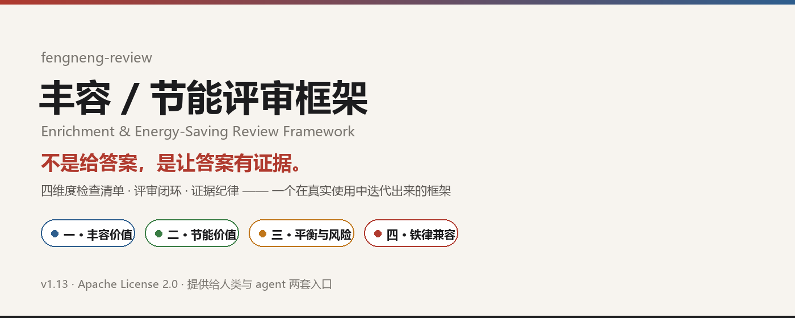
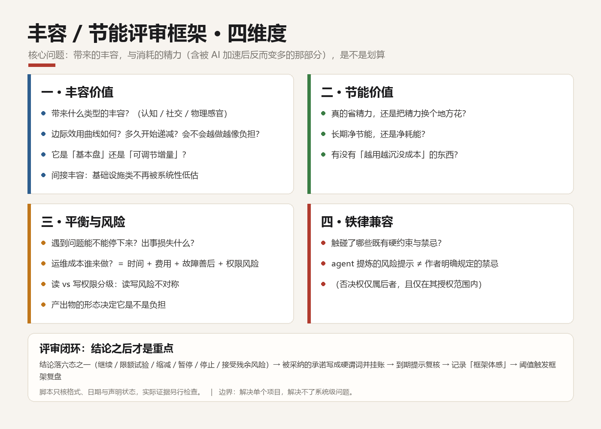
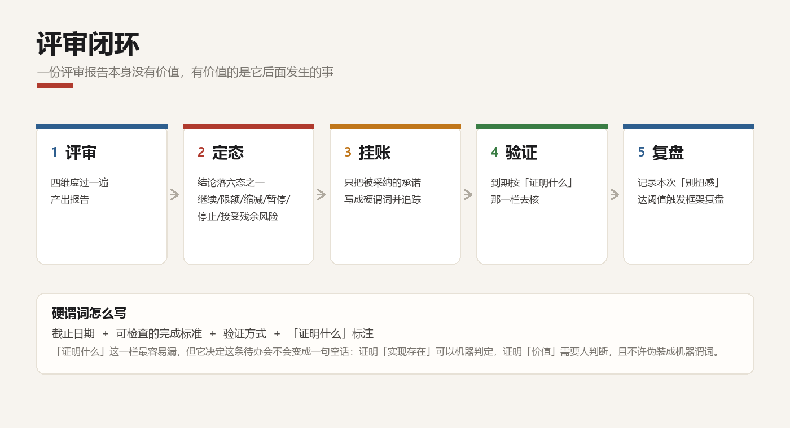
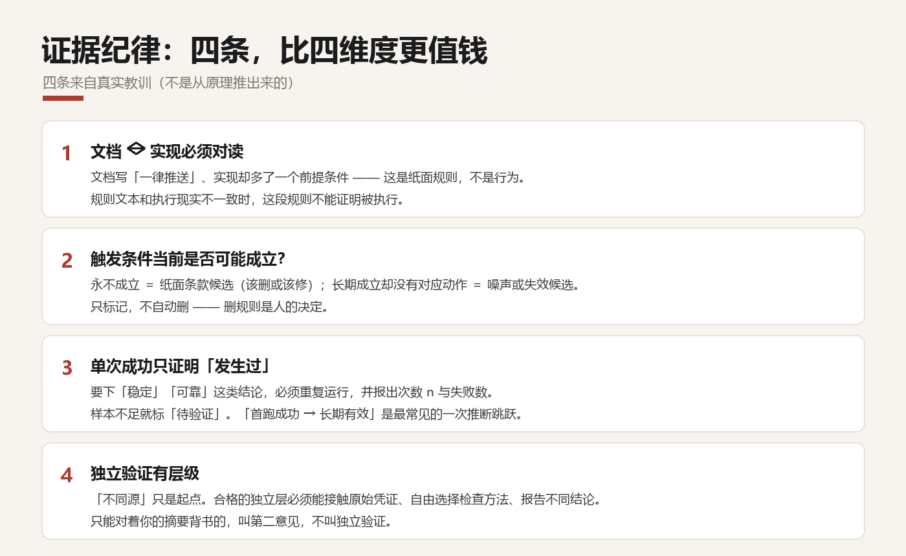

<p align="center">
  
</p>

<p align="center">
  <a href="LICENSE"></a>
  
  
  
  <a href="CHANGELOG.md"></a>
</p>

<p align="center"><sub>四维度检查清单 · 评审闭环 · 证据纪律 —— 一个在真实使用中迭代出来的框架</sub></p>

---

# fengneng-review

> **不是给答案，是帮你把依据和未知分开。**
>
> 框架不保证事实为真，也不替你做决定——它只让这两件事在评审里显形。

大多数"该不该做这个项目"的判断，最后都塌成两种坏结果：

- **凭感觉开工** → 做完发现不值，于是烂尾；
- **凭感觉砍掉** → 砍掉了本该做的那件，而且事后没人说得清为什么。

本框架给的不是答案，是**一段能被复核的判断过程**。

它要回答的核心问题只有一个：

> **这件事带来的丰容（心理 / 社交 / 物理感官的丰富度），
> 和它消耗的精力——包括被 AI 加速之后反而变多的那部分——是不是划算。**

---

## 快速开始

**给 agent 用**（兼容 `SKILL.md` frontmatter 的客户端：Claude Code / Kimi Code / OpenCode 等）：

```bash
git clone https://github.com/yunfy1990/fengneng-review.git
cp -r fengneng-review/skill ~/.claude/skills/fengneng-review   # 换成本机 skill 目录
python -X utf8 ~/.claude/skills/fengneng-review/scripts/fengneng_review_lint.py --selftest
```

然后在对话里说：**"新开一个项目之前，先过一遍丰容评审"**，它就会按 `skill/SKILL.md` 的清单走。

**给人用**：直接读 [`human/为什么需要这套框架.md`](human/为什么需要这套框架.md)，
照着四个维度问一遍，结论落六态之一，被采纳的承诺写成硬谓词挂账。

---

## 四维度



| 维度 | 问的是什么 |
|---|---|
| **一、丰容价值** | 带来什么类型的丰容？边际效用曲线如何？它是"基本盘"还是"可调节增量"？ |
| **二、节能价值** | 长期净节能还是净耗能？（含"越用越沉没成本"） |
| **三、平衡与风险** | 遇到问题时能不能停下来？出错了损失什么？谁来做运维？读写权限风险？ |
| **四、铁律兼容** | 是否触碰既有的硬约束与禁忌？ |

---

## 评审闭环



评审不是终点。框架要求：

1. 结论必须落在六态之一：**继续 / 限额试验 / 缩减 / 暂停 / 停止 / 接受残余风险**；
2. 只有**被采纳的承诺**才写成**硬谓词**（截止日 + 可检查的完成标准 + 验证方式 + "证明什么"标注）并挂账追踪；
3. 每次评审记录**框架体感**，累计到阈值触发**框架复盘**，复盘只改问法、不改结论；
4. **机械闸只验证格式与事实，不替代语义判断**。

> ⚠️ **机械闸的能力边界（请照实理解）**：配套的两个脚本**只做格式与状态判定** ——
> 格式闸核对字段是否齐备、结论是否在档位内；闭环闸读取**截止日期与状态标记**，判断条件是否逾期。
> **它们不执行条件所要求的脚本、不核对文件事实、不验证价值判断。**
> 「条件已到期」只意味着**该核了**，不意味着**核过了**；价值结论仍由人给。

---

## 证据纪律



这部分可能比四维度更值钱 —— 四条来自真实教训（不是从原理推出来的）：

- **文档 ↔ 实现必须对读**。文档写"一律推送"、实现有持仓前提 —— 这是纸面规则，不是行为。
- **触发条件当前是否可能成立**。永不成立 = 纸面条款候选；长期成立却没有动作 = 噪声候选。
- **单次成功只证明"发生过"**。要下可靠性结论，须重复运行并报出次数 n 与失败数；样本不足就标"待验证"，不写"稳定"。
- **独立性有层级**。不同源只是起点；独立层必须能接触原始凭证、自由选择检查方法、报告不同结论。能对摘要背书的，只是第二意见。
  *（独立性要求针对**高风险 / 涉写 / 涉历史口径**的评审；低风险纯只读的自检，由作者自己核即可，不强制独立层。）*

---

## 目录结构

```
fengneng-review/
├─ README.md          ← 本文件（人类入口）
├─ human/             ← 人类长文版：这套东西怎么来的、踩过什么坑
├─ skill/             ← agent 版：SKILL.md + references/ + 两支机械闸
├─ docs/              ← 配图（hero / 四维度 / 闭环 / 证据纪律）
├─ scripts/           ← 配图生成脚本（可复现，改文案后可重跑）
├─ CHANGELOG.md       ← 14 版设计沿革
├─ NOTICE             ← 署名与引用礼仪
└─ LICENSE            ← Apache License 2.0
```

| 路径 | 给谁看 | 干什么 |
|---|---|---|
| `human/为什么需要这套框架.md` | 人 | 框架的来历、两个烂尾项目、边界声明 |
| `skill/SKILL.md` | agent | 评审流程本体，含触发条件与硬护栏 |
| `skill/references/HISTORY.md` | agent / 人 | 每一轮迭代"补了哪条问法、为什么补" |
| `skill/scripts/fengneng_review_lint.py` | agent | 评审记录的字段格式校验（`--selftest` 自检） |
| `skill/scripts/fengneng_review_followup.py` | agent | 条件到期追踪 + 复盘触发两线判定（`--selftest` 自检） |

---

## 边界声明（请认真读这一段）

- 本框架**只产出判断与风险提示，不产出授权**。否决权仅属作者明确规定的禁忌范围。
- 框架的适用范围是**单个项目 / 产品 / 重大功能**。**它解决不了系统级问题** —— 当问题的对象是
  "若干局部机制之间的相互关系"时（例如"每个局部的产出都会变成另一个局部的投入"），
  本框架不提供判据，需要升到系统视角单独处理。
- 四条铁律是 agent 从真实烂尾案例中提炼的**场景化风险提示**，未经普遍化为所有机制的禁忌。

---

## 致谢与来源

本框架是在既有材料之上做的**组合与改造**：相关领域已有先例（人-AI 协作指南、项目阶段门治理、
AI 风险管理框架里的非金钱成本与残余风险接受等）。设计之初专门查过，**未找到同一完整组合，
但这不等于首创**；本框架的具体贡献见设计沿革。设计沿革见 [`CHANGELOG.md`](CHANGELOG.md) 与
[`skill/references/HISTORY.md`](skill/references/HISTORY.md)，其中记录了每一轮迭代"补了哪条问法、为什么补"。

> 一个只讲结论不讲来路的评审框架，本身就违反了自己的证据纪律。

---

## License

[Apache License 2.0](LICENSE) —— 含**专利授权**条款：贡献者就其贡献必然涉及的专利权利授予使用者许可。

> ⚠️ 请照实理解：专利授权只覆盖**贡献者可许可的特定专利权利**（贡献必然涉及的那部分），
> **不等于对第三方专利的全面免责**。若你要在商业场景依赖某项专利，仍需自行核查。

引用或二次分发请注明出处（见 [NOTICE](NOTICE)）。
